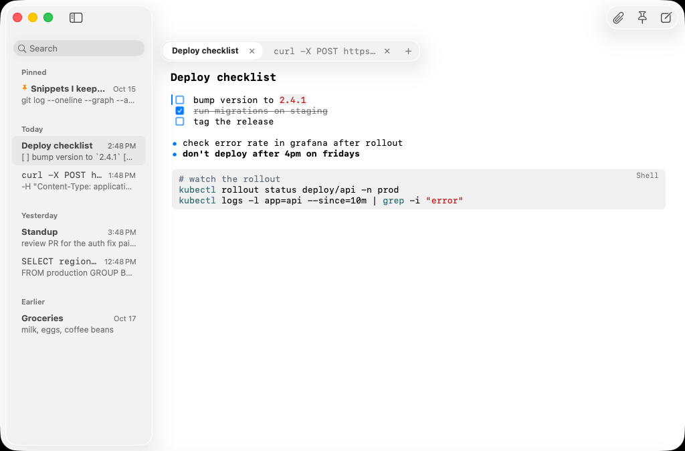
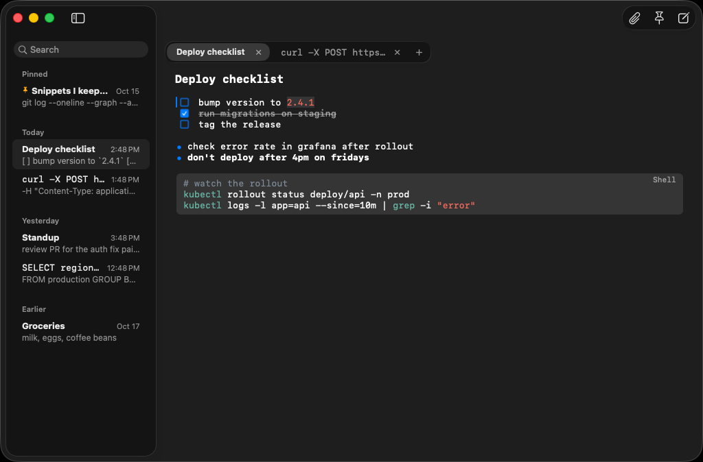
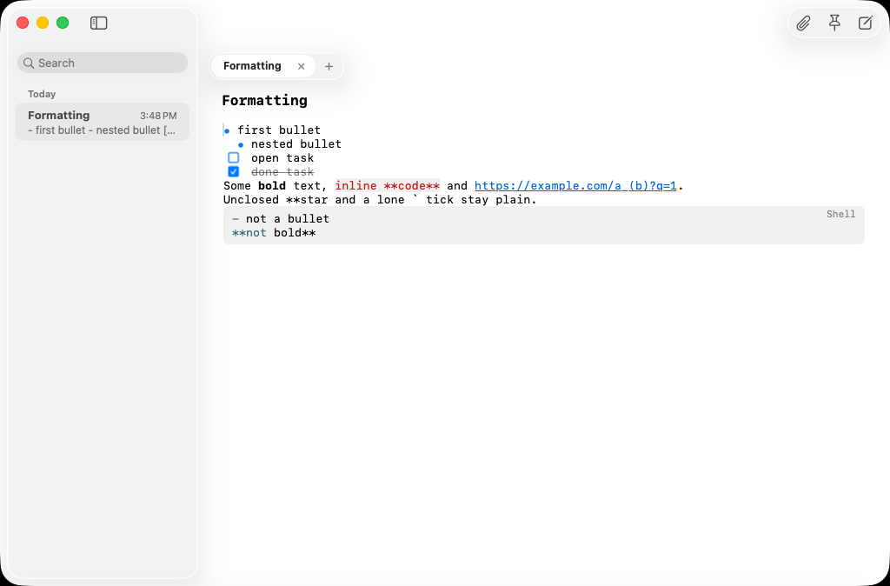
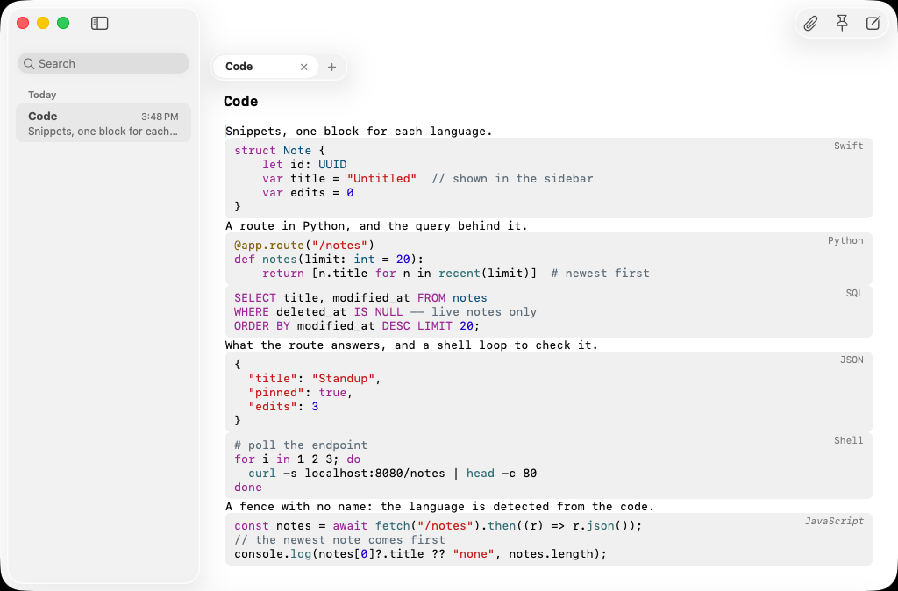
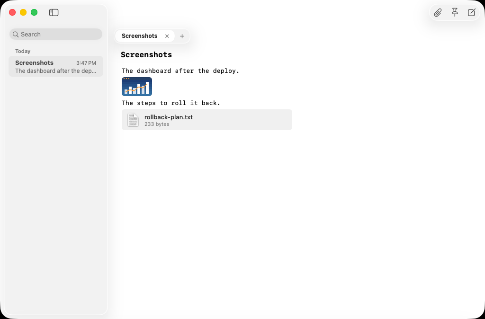
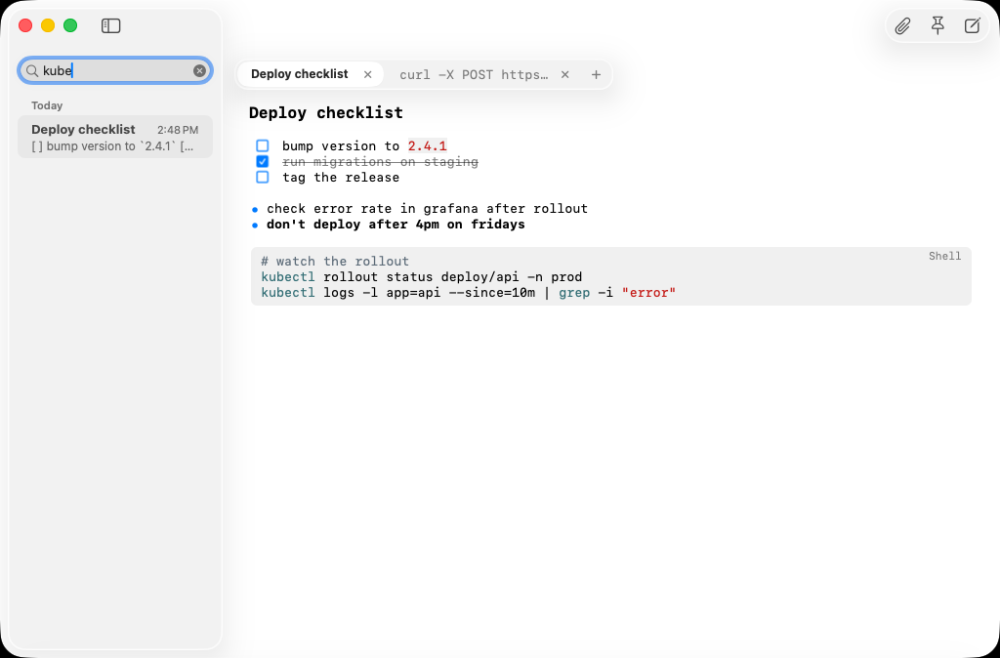
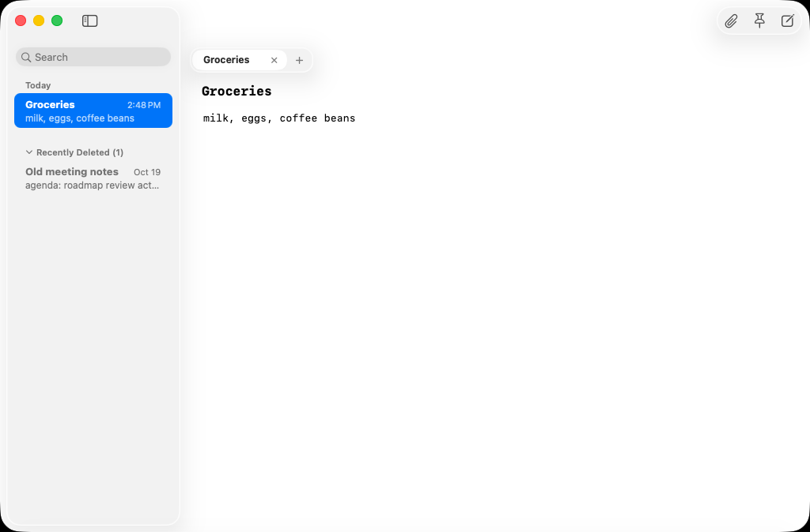

# Scratch

A native macOS scratchpad. It is a window that is always ready to type in, never asks you to save, and brings
everything back when you open it again. It is made for one person on one Apple Silicon Mac, for code snippets, quick
notes and todo lists.

  
  

## Why

On Windows, Notepad was the place for anything you did not want to file: open it, type or paste, close it without
saving, and find it all again next time. Scratch is that habit on the Mac, with just enough structure for what ends up
there: code snippets, quick notes and todo lists. Text you paste always takes the note's font, whatever it was copied
from, and text you copy always comes out as plain text.

## What it does

Scratch is at version 0.5, which does these things:

- **Always ready.** It opens to a note you can type in at once. There is no Save and no file to name: everything you
  type is written within about a second, and a crash or a force-quit loses at most that second. Quitting and opening
  the app again restores your tabs, the active one, and the cursor and scroll position in each.
- **Pasted text takes the note's font, copied text comes out plain.** Whatever you paste from a browser, Word or a
  terminal, only its text is used. Whatever you copy goes out as plain text, with nothing of the note's font. Every
  note uses one monospaced font (SF Mono, 13 pt by default; ⌘+, ⌘− and ⌘0 change the size for all notes). Nothing
  is autocorrected, so pasted code keeps every character.
- **Notes with an optional title, and tabs.** A note can have a bold title above its text. Tabs sit in a glass strip
  above the note, each with its own cursor, scroll position and undo history.
- **A sidebar that finds things.** Notes are grouped as Pinned, Today, Yesterday and Earlier, newest edit first. Pin a
  note (the pin button or ⇧⌘P) to keep it at the top. The search field filters the notes as you type, over titles and
  text.
- **Deleting is undoable.** Delete a note from its right-click menu, or with ⌘⌫ in the sidebar. It moves to Recently
  Deleted, where you can restore it, and is removed for good after 30 days.
- **Just enough formatting, from what you type.** `- ` is a bullet, `[ ] ` and `[x] ` are checkboxes you can click
  (ticked ones are struck through), `**bold**` is bold, `` `code` `` is tinted, and `http(s)://` links open with
  ⌘-click. Return continues a list, Tab and ⇧Tab indent it, ⌘B makes text bold and ⇧⌘L makes a checklist. The `**` and
  the backticks hide, except where the caret is. Bold needs a word boundary on each side, so `x**2 + y**2` and
  `src/**/*.ts` stay plain text. What is stored never changes, so copying a note out gives the characters you typed,
  `- ` and `**` included. Inside a fenced block (three backticks), and inside inline code, every character stays
  exactly as typed.
- **Code looks like code.** A fenced block (a line of three backticks, the code, a line of three backticks) is drawn as a
  tinted, rounded block with a small language label at its top right, and the code is coloured in the colours of Xcode's
  default theme, light and dark, for 17 languages: Swift, Python, JavaScript, TypeScript, JSON, Shell, SQL, YAML,
  HTML, CSS, C#, Go, Rust, C, C++, Java and PowerShell. The fence lines shrink to a little padding and come back where
  the caret is. A block you type with no language on its fence gets one from its code (shown in italics, which means
  "automatic"). Colouring never changes a character, and a block too long to colour (over 5,000 lines or 300,000 characters)
  stays tinted and plain.
- **Pasted code is fenced for you.** Paste two lines or more of code and Scratch puts them in a fence with the language
  it detected, with every pasted character kept as it was. It works offline, and when it is unsure it leaves your text
  alone: an email, a list, meeting notes with times, a log, a CSV row or a note of `name: value` lines stay plain text. ⌘Z once gives back exactly the
  text you pasted, and ⌘Z again removes it. Click a block's label to choose another language, to show the block as
  plain text, or to take the fence off (Not Code), each one undo step.
- **Images and files, right in the note.** Paste an image or a file you copied in Finder, drop one on the note, or click
  the paperclip (⇧⌘A), and it sits in the note on a line of its own: an image as a preview, as wide as the text and up
  to 240 pt high, and any other file as a chip with its icon, name and size. Double-click one to open the file with its
  default app, and drag it out of the note to give the file to Finder, Mail or any app that takes files. Scratch keeps its
  own copy of every file, so the original can be moved or deleted, and removes the copy only when no note, Recently
  Deleted included, refers to it any more. Backspace next to an attachment selects it before the next press deletes it,
  and ⌘Z brings a deleted one back, file and all. Copying text with attachments in it writes the file names, and copying
  exactly one attachment copies the file (or the image) as well. When a paste holds files, text and an image, the files
  win, then the text (Excel and Word paste text, not a picture of it), and an image comes in only when there is no text.
- **Made for macOS 26.** The sidebar, the tab strip and the toolbar buttons are native Liquid Glass, and the app is
  built only for Apple Silicon.

  

  

  

  
  

Coming in the next release:

| Release | Adds |
|---|---|
| 1.0 | Performance and accessibility polish |

The plan behind that order is in [the roadmap](docs/superpowers/plans/2026-10-19-roadmap.md).

## Install

Scratch needs macOS 26 on a Mac with Apple Silicon.

1. Download `Scratch-<version>.dmg` from the [latest release](https://github.com/ldellisola/scratch-mac/releases/latest)
   and open it.
2. Drag Scratch onto the Applications folder in the window that opens, then eject the disk image.
3. Open Scratch. macOS blocks the first launch of every new version, because the app is not notarised. Go to
   System Settings → Privacy & Security, scroll down to the message about Scratch and click **Open Anyway**. In Terminal,
   `xattr -dr com.apple.quarantine /Applications/Scratch.app` does the same.

To update, do the same with the new release and choose Replace. Your notes live in
`~/Library/Application Support/Scratch`, not in the app, so replacing the app never touches them. Every release also has
`Scratch-<version>.zip` with the same app, if you prefer a zip.

## Keyboard shortcuts

| Shortcut | Does |
|---|---|
| ⌘N, ⌘T | New note, in a new tab at the end of the strip |
| ⌘W, ⇧⌘W | Close the tab, close the window (which quits) |
| ⌃Tab, ⌃⇧Tab | Next and previous tab |
| ⌘1 to ⌘8, ⌘9 | The tab with that number, the last tab |
| ⌘-click a note | Open it in a new tab next to the active one |
| ⇧⌘P | Pin or unpin the note |
| ⌥⌘F | Search the notes. ⌘F finds inside the open note |
| ⌘⌫ | Delete the highlighted note, while the sidebar has the keyboard |
| ⌃⌘S | Show or hide the sidebar |
| ⌘+, ⌘−, ⌘0 | Bigger, smaller, actual text size |
| Return | In a list, a new item below (a new checkbox is open). On an empty item it ends the list, or outdents the item |
| Tab, ⇧Tab | In a list, indent or outdent the item (every list line of the selection) |
| ⌘B | Bold: put `**` around the selection, or take the stars off a bold run |
| ⇧⌘L | Turn the selected lines into a checklist, or back into plain lines |
| ⌘-click a link | Open the `http://` or `https://` link in your browser. A plain click only places the caret |
| ⌘V | Paste as plain text. Two lines or more of code are then wrapped in a fence with their language: ⌘Z once leaves the plain paste. Files copied in Finder, and an image that comes with no text, become attachments |
| Click a code block's label | Choose the block's language, show it as plain text, or take its fence off (Not Code) |
| ⇧⌘A, the paperclip | Attach files: choose them in a sheet, and they go in at the caret (File > Attach File…) |
| Click an attachment | Select it (⌘C copies its file and its name, ⌘X cuts it) |
| Double-click an attachment | Open its file with its default app |
| Drag an attachment out | Give its file to Finder, Mail or another app. Scratch's own copy stays in the note |
| Backspace after an attachment, Delete before it | Select it. Press again to delete it (⌘Z brings it back) |

## How it is built

Scratch is developed only by AI agents. The app is a thin AppKit shell (a TextKit 1 editor, and a Liquid Glass sidebar
and tab strip) over two Swift packages that build and test on Linux as well as on macOS: `ScratchCore`, which is
Foundation-only and holds the rules and the SQLite storage, and `ScratchCode`, which wraps
[tree-sitter](https://tree-sitter.github.io/) (the one third-party dependency) to colour code and to detect it. The
licences of tree-sitter and its grammars are in the About panel.
Everything that needs a Mac runs on GitHub's Macs, and each merge that changes the app publishes a release.

- [AGENTS.md](AGENTS.md): the entry point for anyone working on the repository: commands, how to verify a change, and
  the pitfalls found so far
- [The design](docs/superpowers/specs/2026-10-19-scratchpad-design.md), [the roadmap](docs/superpowers/plans/2026-10-19-roadmap.md)
  and [the architecture](docs/architecture.md)
- [`docs/features`](docs/features) (what each feature does) and [`docs/decisions`](docs/decisions) (why it is that way)
